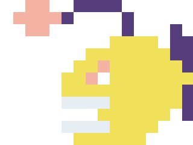

  <ul align="center" style="list-style: none">
    

      <h1>
        👋 Hi, my name is Ángel!
      </h1>
    

  </ul>

**<h3 align="left">Connect with me:</h3>** 

  

**<h3 align="left">🚀 Computer Engineering student from the UAEMEX currently in third year, with experience developing Backend and Frontend, focused on REST architecture in Java and Spring Boot</h3>**

**<h3 align="left">Rapid Fire</h3>**

- 💼 I'm currently working on: **💻 FullStack apps**

- 🌱 I'm currently preparing for: **📚 Any tech internship!**

- 💬 Ask me about: **💡 Java, javascript, Spring Boot, PSQL, Linux, and RESTful APIs**

- 🏆 Achievement: **Semi-finalist of the Talent Land Hackathon 2026 (Fondo Seguro)**

- 🎯 Open to: Summer internships, Junior Backend roles, or Open Source collaborations.

- ⚡ Fun fact: i have a pet turtle.

- 🗣️ Languages: Native Spanish, Fluent English.

**<h3 align="left">Skills</h3>**

   
   
   
   
   
   
   
   
   
   
  
  
  

**<h3 align="left">GitHub Stats</h3>**

<table>
  <tr>
    <td align="center" valign="middle">
      
    </td>
    <td align="center" valign="middle">
      <!-- MOST_USED_LANGUAGE_START -->
      <b>my most used language: <code>JavaScript</code></b>
      <!-- MOST_USED_LANGUAGE_END -->
        
      
    </td>
  </tr>
</table>

